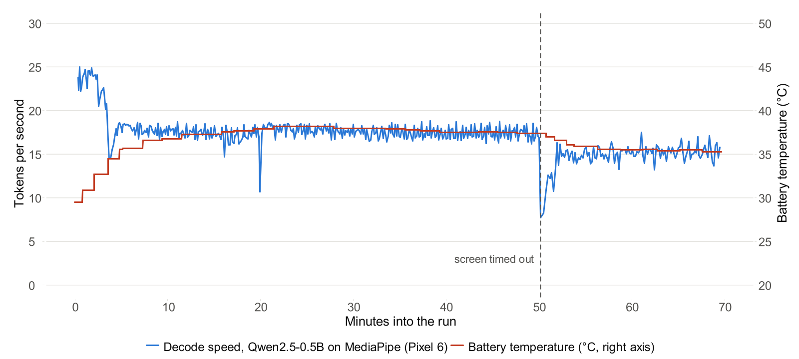
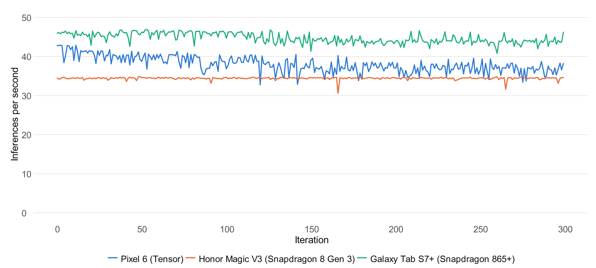
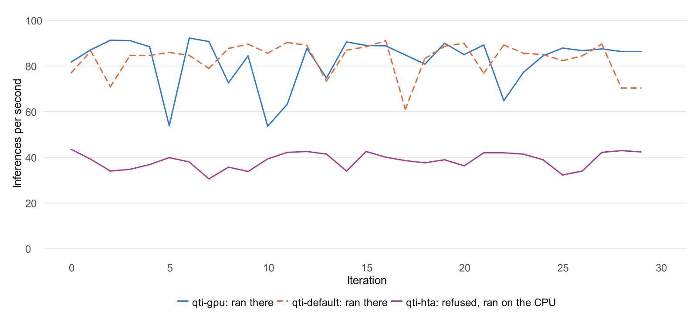
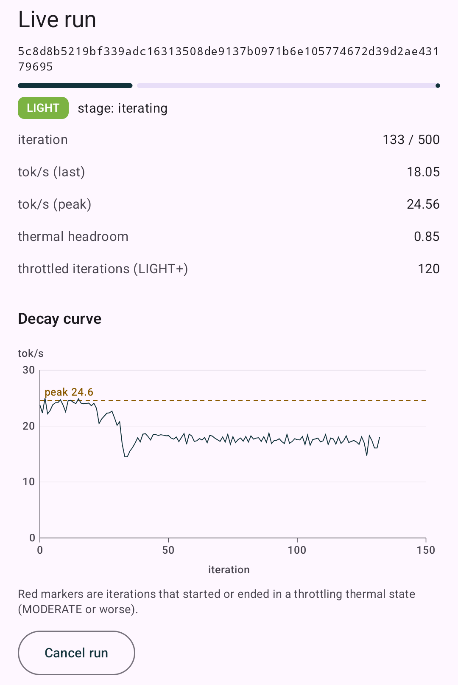

<div align="center">

# VeriSpec-AI

**Signed, checkable evidence of how an AI model really behaves on real phones.**




*A small language model (Qwen2.5-0.5B on MediaPipe) generating text non-stop for 70 minutes on an unplugged Pixel 6. It starts at about 24 tokens a second, slows to about 18 within a few minutes as the phone warms up, and holds there. The last stretch ran with the screen off, after the phone's screen timed out, which is why it is slower.*



*The same image model (EfficientNet-Lite0 on LiteRT) run 300 times on three devices. Each one runs at its own speed: the Honor barely changes, while the Pixel 6 slows down the most as it warms.*



*The same image model on a OnePlus 8T, each time tied to a different chip through Android's route to AI accelerators. The graphics chip (`qti-gpu`) and Android's default choice (`qti-default`) both run it at about 86 inferences a second and give identical answers, so the default is really the graphics chip. The dedicated AI chip (`qti-hta`) refused the model, which uses a number format it cannot handle, and the run fell back to the main processor at about 39. The signed result records that fallback instead of claiming the AI chip did the work.*



*The app's Live Run screen, part-way through the 70-minute run above.*

</div>

VeriSpec-AI is an Android toolkit for proving how an AI model behaves on real phones.

Getting a model to run on a phone is easy these days. What is much harder is showing, in a way someone else can check, how that model actually behaves once it is out in the world: how fast it runs, whether it slows down as the phone warms up, whether it gives the same answer on different phones, and what it was really running on. VeriSpec-AI runs the model on the phone, measures all of that, and packs the results into a signed file called an evidence bundle, which anyone can later check has not been altered.

The project is written in Kotlin with Jetpack Compose, and comes with an Android app, a desktop command-line tool, and a PDF report generator.

## What you get from a run

Each run produces one evidence bundle. Inside it you will find:

- **Where it came from**: which model file was used, which AI engine ran it, and which phone, chip and Android version it ran on, all recorded at the time of the run rather than typed in by hand. When a run asks for a particular processor, such as the graphics chip or a dedicated AI chip, the bundle also lists the processors the phone offered and records whether the one asked for actually did the work.
- **How it performed over time**: its best speed, the speed it settled at, how long it took before the phone started slowing itself down to manage heat, and how much power it drew.
- **How consistent it was**: fingerprints of every answer the model gave, so runs on different phones can be compared to see whether they agree.
- **What the rules ask for**: a list linking each piece of evidence to the regulations and standards that call for it (such as the EU AI Act and ISO/IEC 42001), with any gaps named openly.

A bundle never contains the model's actual output, only fingerprints of it, because what a model says can include personal information taken from its input.

The bundle is signed with a key that lives in the phone's secure hardware. Changing even one character afterwards breaks the signature, and the signature itself shows that it came from a genuine Android device and belongs to that particular run.

## Which AI engines it supports

VeriSpec-AI can run models through four on-device engines: **LiteRT** (formerly TensorFlow Lite), **ExecuTorch**, **llama.cpp** and **MediaPipe**. Every engine goes through exactly the same measuring code, so no engine gets special treatment and the numbers can be fairly compared. If an engine is not available on a phone, the run simply records that as a gap instead of failing.

The app also offers a handful of ready-made starter models, which it downloads on request, so you can try it without bringing your own.

## How far it has got

All four engines have now run real models on a Google Pixel 6. LiteRT has been tested the most, including a comparison of the same model on three different phones (a Pixel 6, an Honor Magic V3 and a Samsung Galaxy Tab S7+). The built-in language model has also been through a long test of over an hour, and all four engines have had short trials on the Honor Magic V3 too, where the language models gave exactly the same answers as on the Pixel. The other engines have so far had shorter trials that show they work, rather than full measurements, and every result so far comes from a small number of phones. The manuals describe exactly what has and has not been tested.

The first tests away from the main processor ran on a Samsung Galaxy Tab S7+ and a OnePlus 8T, which share the same Qualcomm chip. Through Android's route to AI accelerators, the image model ran almost twice as fast as on the main processor, and the two devices gave identical answers there, but the work went to the graphics chip rather than the dedicated AI chip. The language model failed on the graphics chip of every device tried (the Pixel 6, the tablet and the OnePlus), and the app now stops cleanly when that happens rather than sealing an empty result. On the OnePlus, the language model on the main processor gave exactly the same answers as on the Pixel 6. Nothing has run on a dedicated AI chip yet; that will most likely need a model stored in a smaller number format, which those chips are built for.

## Learning more

The `DOCS/` folder holds three documents, all generated from the project's own code. The charts at the top of this page are drawn the same way, straight from the signed result files, so they show exactly what was recorded:

| Document | Who it is for |
| --- | --- |
| `VeriSpec-AI-Overview-for-Non-Engineers_02.pdf` | Anyone wondering whether the project matters to them. A short, plain-language introduction. |
| `VeriSpec-AI-Manual_02.pdf` | Quality and regulatory staff, product managers, auditors and newcomers. Plain language throughout. |
| `VeriSpec-AI-Developer-Manual_02.pdf` | Developers working on or reviewing the code: the architecture, the rules the design protects, and how to extend it. |

## Building it

You will need JDK 17 and the Android SDK with platform 36 installed. Create a `local.properties` file containing `sdk.dir` pointing at your SDK (use forward slashes on Windows), then run:

```
./gradlew build                     # build and test everything
./gradlew :app:ui:assembleDebug     # just the Android app
./gradlew :tools:cli:installDist    # the command-line tool
./gradlew :tools:report:generateDocs  # regenerate the documents and the charts above
```

Run `./gradlew clean` on its own rather than together with other tasks, because combining them can make Gradle stall.

The llama.cpp engine needs its source code, which is kept as a git submodule. To fetch it (you will also need the Android NDK and CMake):

```
git submodule update --init --depth 1
```

Without it, everything else still builds, and the app simply reports llama.cpp as unavailable.

## Checking a bundle

The command-line tool can check any bundle on a computer:

```
verispec verify bundle.json
```

It confirms:
- that the file has not been changed since it was signed;
- that the signature came from genuine Android hardware whose certificate chain leads back to Google;
- that the signature belongs to this particular run;
- that the phone was locked and running its manufacturer's own software;
- that the key was made by the real VeriSpec-AI app, recognised by the certificate the app was signed with.

So far the only app build it recognises is the developer's own test build; `--trusted-signer` adds another, such as your own build's signing key. The app's Verify screen does the same check on the phone, and also accepts its own build. Whether the phone's security key has since been revoked is not checked yet, and the manuals explain what that means.

The tool can do more than verify, including comparing bundles from different phones and producing a PDF report. Run `verispec --help` to see everything it offers.

## Licence

Copyright (c) 2026 uwechue-o. All rights reserved; see [LICENSE](LICENSE). Third-party components keep their own licences.

The PDF reports are produced with Apache PDFBox, which uses the permissive Apache-2.0 licence. The more familiar iText library was ruled out because its AGPL licence would pass strict obligations on to anyone using this toolkit, which matters for the medical-device and automotive companies it is meant for.
